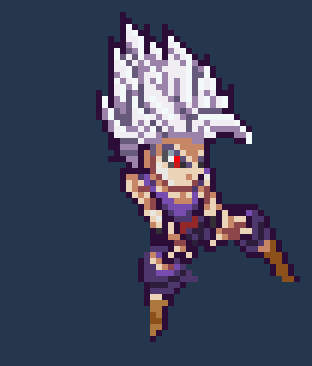
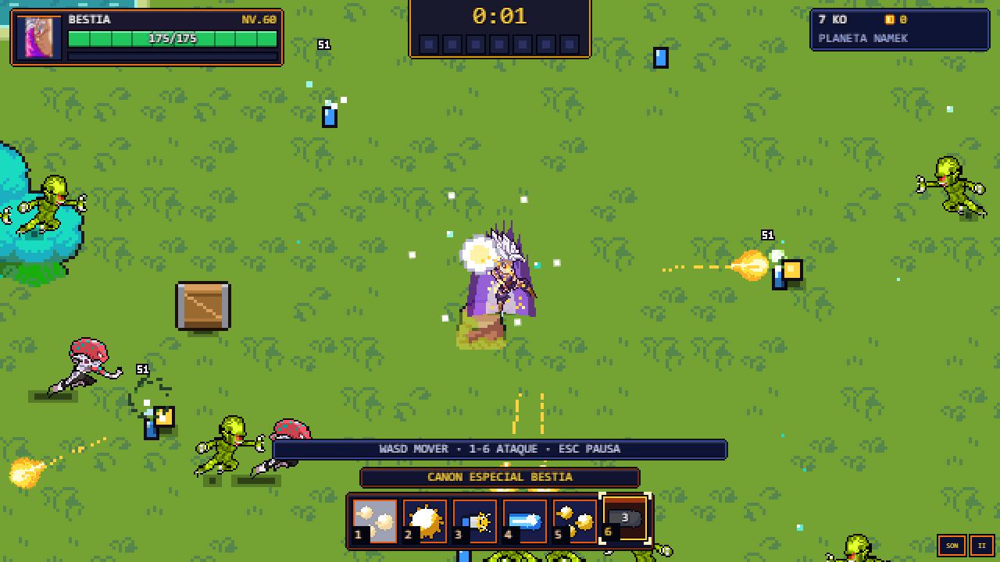
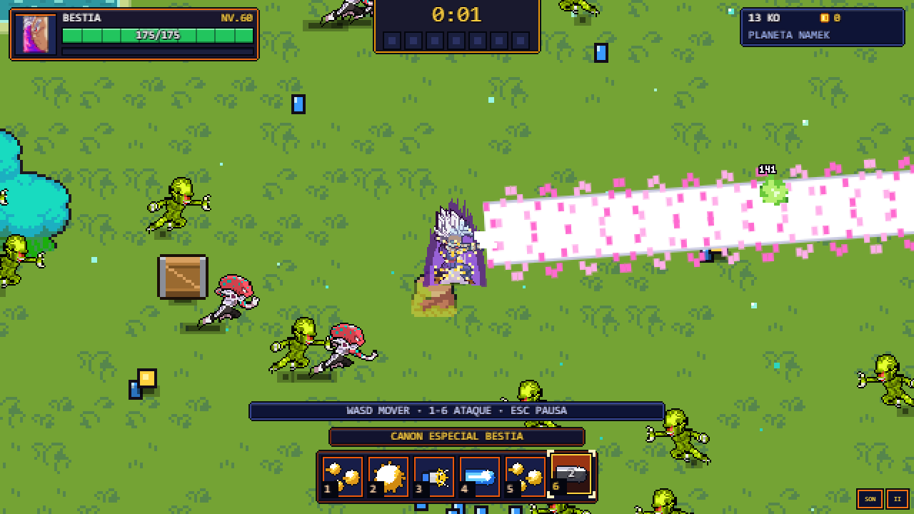

# Gohan Bestia — revisión del 9 de noviembre de 2026

## Corrección
- La transformación `gohan/4` utiliza el Cañón Especial Bestia en su sexta ranura (nivel 16), en lugar del Kamehameha Padre-Hijo. El resto de formas conserva sus técnicas.
- La forma ahora se llama BESTIA y usa aura morada; antes heredaba DEFINITIVO y su aura por faltar la quinta entrada del registro.
- Secuencia `tecnica_beastcannon`: fotogramas 14 → 18 del mismo pack 119, con preparación de 30 ticks y disparo de 18. Dedos en la frente y extensión del brazo. Anclas de emisión para ambas fases.
- El visor Python ahora admite secuencias `tecnica_ID` al generar GIFs. Antes fallaba al buscar estas acciones en la tabla fija.

La técnica está documentada por el [sitio oficial de Dragon Ball](https://en.dragon-ball-official.com/news/01_1823.html).

## Pruebas
- Sintaxis JS; comprobaciones de ataques, combate, personajes y catálogo: correctas. Catálogo: 313 formas, 3354 animaciones, 6538 fotogramas.
- Regresión por forma: Bestia, otras formas, lista base y fusión de otra ranura, correctas.
- Ocho pruebas de Piskel: correctas. Temporales dentro del espacio de trabajo por las restricciones del entorno.
- Chrome con `file://`: carga del juego, carga/disparo de la ranura 6, nombre/aura y selección de la animación propia correctos; cero errores JavaScript. Comprobado también que Definitivo conserva `fskame`.
- Prueba dirigida: se forzaron nivel 60, seis ranuras y la forma mediante la API de depuración. No es una partida de progresión normal ni una prueba completa del plantel.
- Índice regenerado frente a las rutas versionadas de Git (checkout parcial): sin cambios, 336 entradas y cero rutas ausentes.

## Secuencia revisada

## En el juego

## Pendiente
Continuar por personaje y transformación visible, revisando las técnicas que todavía usan poses de reserva. Falta jugar la progresión normal de Bestia. No se han fusionado ramas de Claude ni publicado cambios en main o GitHub Pages.
